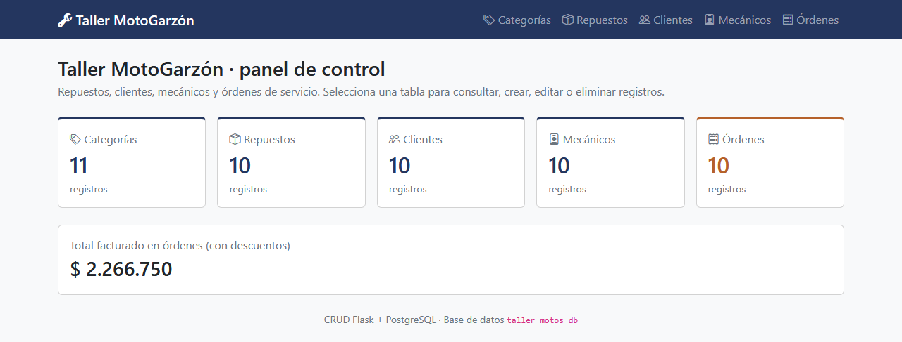
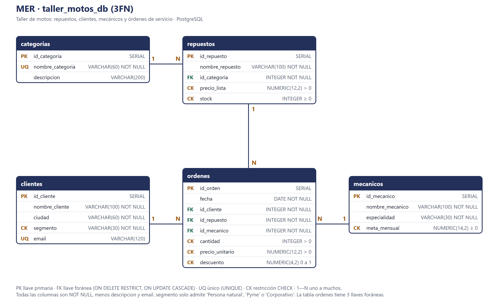
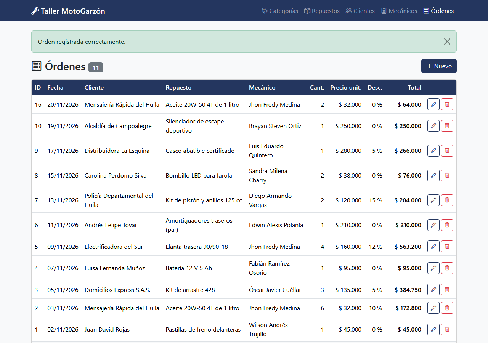
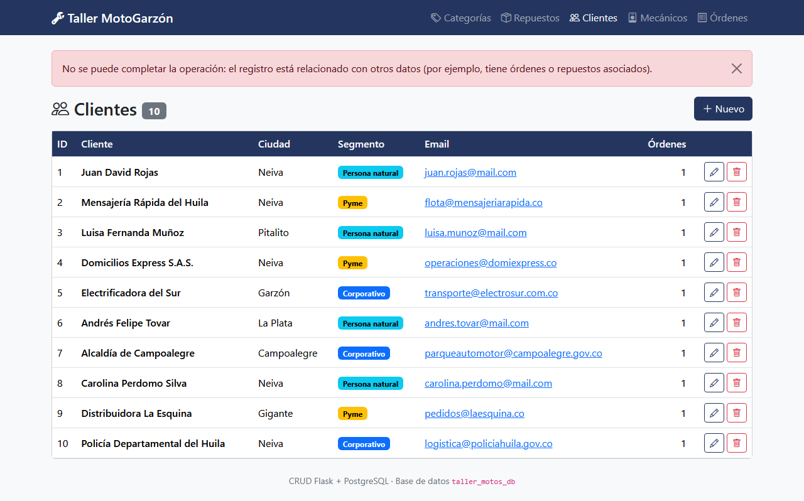

# Taller MotoGarzón · CRUD con Flask y PostgreSQL

Proyecto final de **Programación Web** (Universidad Surcolombiana, 2026-2), profesor Jose Miguel Llanos Mosquera.

**Integrante:** José Manuel Garzón Durán · código 20242228211

Aplicación web para administrar un **taller de motos**: categorías de repuestos, repuestos, clientes, mecánicos y
órdenes de servicio. Permite listar, crear, editar y eliminar registros de las **5 tablas** de la base
`taller_motos_db`. La tabla `ordenes` tiene **3 llaves foráneas** (cliente, repuesto y mecánico).

Partimos de la plantilla `crud_ventas` del profesor y la adaptamos al taller: misma estructura (un blueprint por
tabla, `db.py`, validaciones, macros y pruebas), con las tablas, los campos y los datos del taller.

Tecnologías: Python 3.10+, Flask 3, psycopg2, PostgreSQL, Bootstrap 5 (desde CDN), pytest.



## Modelo de datos



| Tabla | Qué guarda | Relación |
|---|---|---|
| categorias | Tipos de repuesto (frenos, motor, eléctrico…) | 1 categoría → N repuestos |
| repuestos | Repuestos con precio y stock | FK a categorias |
| clientes | Dueños de las motos | 1 cliente → N órdenes |
| mecanicos | Mecánicos con especialidad y meta mensual | 1 mecánico → N órdenes |
| ordenes | Órdenes de servicio | FK a clientes, repuestos y mecanicos |

- Modelo entidad-relación y justificación de la 3FN: [PDF](docs/modelo_3FN.pdf) · [Word](docs/modelo_3FN.docx)
- Diccionario de datos: [PDF](docs/diccionario_de_datos.pdf) · [Word](docs/diccionario_de_datos.docx)
- Plan de pruebas, 3 casos por tabla (15 en total) con sus capturas: [PDF](docs/plan_de_pruebas.pdf) · [Word](docs/plan_de_pruebas.docx)

## Estructura

```
taller-motos/
├── app.py               # Punto de entrada: crea la app y registra los blueprints
├── config.py            # Lee la configuración del archivo .env
├── db.py                # Conexión a PostgreSQL y funciones query / execute
├── validators.py        # Validaciones de los formularios
├── routes/              # Un blueprint (CRUD) por tabla
│   ├── categorias.py
│   ├── repuestos.py
│   ├── clientes.py
│   ├── mecanicos.py
│   └── ordenes.py
├── templates/           # base.html, _macros.html, index.html y <tabla>/list.html, <tabla>/form.html
├── static/css/styles.css
├── database/
│   ├── 01_creacion.sql  # Crea las 5 tablas
│   ├── 02_carga.sql     # 10 registros por tabla
│   └── backup.sql       # Respaldo completo de la base (pg_dump, formato plano)
├── docs/                # MER, 3FN, diccionario, plan de pruebas y capturas
├── tests/test_crud.py   # 32 pruebas automáticas
├── requirements.txt     # Librerías de la aplicación
├── requirements-dev.txt # + pytest
├── .env.example         # Plantilla de configuración
└── setup.sh             # Instalación rápida en macOS / Linux
```

## Instalación

1. Clonar el repositorio y entrar a la carpeta:
   ```bash
   git clone <url-del-repositorio>
   cd taller-motos
   ```
2. Crear el entorno virtual e instalar las librerías (en macOS, `bash setup.sh` hace los pasos 2 a 4):
   ```bash
   python3 -m venv .venv
   source .venv/bin/activate        # En Windows: .venv\Scripts\activate
   pip install -r requirements-dev.txt
   cp .env.example .env             # En Windows: copy .env.example .env
   ```
3. Revisar `.env` con los datos de PostgreSQL. Con **Postgres.app** (Mac) el usuario `postgres` entra sin
   contraseña, así que `DB_PASSWORD` queda vacío.
4. Crear la base y cargar los datos:
   ```bash
   createdb -U postgres taller_motos_db
   psql -U postgres -d taller_motos_db -f database/01_creacion.sql
   psql -U postgres -d taller_motos_db -f database/02_carga.sql
   ```
   (O restaurar todo de una vez con `psql -U postgres -d taller_motos_db -f database/backup.sql`.)

## Ejecutar

```bash
source .venv/bin/activate
python app.py
```

Abrir **http://127.0.0.1:5001**. Se usa el puerto 5001 porque en macOS el 5000 lo ocupa el *Receptor AirPlay*.

## Pruebas

```bash
python -m pytest -v
```

Son 32 pruebas sobre la base real. Cada una crea sus registros (con prefijo `ZZ_TEST_`) y los borra al terminar.

## Detalles

- **Listados con nombres, no IDs:** los listados hacen `JOIN` para mostrar el nombre de la categoría, del cliente,
  del repuesto y del mecánico.
- **Editar** abre el formulario con los datos actuales; **eliminar** usa POST y pide confirmación.
- **Descuento:** en la base se guarda como fracción (`0.10`) y en el formulario se escribe en porcentaje (`10`).
- **Integridad:** las llaves foráneas son `ON DELETE RESTRICT`. Si se intenta borrar un cliente con órdenes, la app
  muestra un mensaje en vez de fallar. Los errores de PostgreSQL (23503, 23505, 23514, 23502) se traducen a
  mensajes en español en `db.py`.
- **Seguridad:** todas las consultas son parametrizadas (`%s`), lo que evita la inyección SQL. La configuración y la
  contraseña van en `.env`, que no se sube a GitHub (está en `.gitignore`).

## Capturas

| Listado de órdenes (3 llaves foráneas) | Mensaje al borrar un cliente con órdenes |
|---|---|
|  |  |
