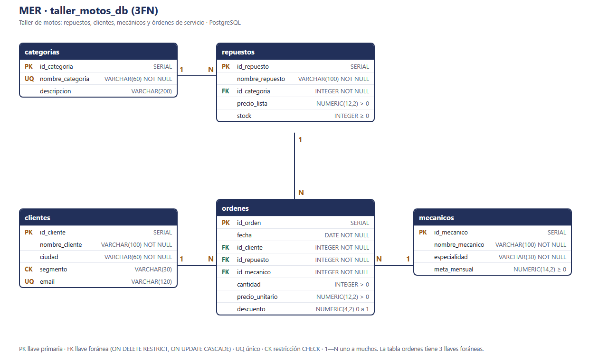

# Modelo entidad-relación y justificación de la 3FN

## Qué guarda cada tabla

| Tabla | Qué guarda | Relación |
|---|---|---|
| `categorias` | Tipos de repuesto: frenos, motor, sistema eléctrico… | 1 categoría tiene N repuestos |
| `repuestos` | Lo que el taller vende e instala, con su precio y su stock | N repuestos pertenecen a 1 categoría |
| `clientes` | Dueños de las motos: personas, pymes (mensajerías) o entidades | 1 cliente tiene N órdenes |
| `mecanicos` | Mecánicos del taller, con su especialidad y su meta mensual | 1 mecánico atiende N órdenes |
| `ordenes` | Cada orden de servicio: qué repuesto se le instaló a qué cliente y qué mecánico lo hizo | Tiene **3 llaves foráneas**: cliente, repuesto y mecánico |

Las cuatro relaciones son de **uno a muchos (1:N)**. Todas las llaves foráneas usan `ON DELETE RESTRICT`
(no deja borrar, por ejemplo, un cliente que tiene órdenes) y `ON UPDATE CASCADE`.

## Por qué está en tercera forma normal (3FN)

**1FN · valores atómicos y sin grupos repetidos.** Cada celda guarda un solo valor: una orden tiene un solo
repuesto y una cantidad; si un cliente lleva tres repuestos, son tres filas en `ordenes`, no tres columnas. Cada
tabla tiene llave primaria (`SERIAL`).

**2FN · todo depende de la llave completa.** Todas las llaves primarias son de una sola columna (`id_...`), así que no
puede haber dependencias parciales: cada columna depende de toda la llave.

**3FN · sin dependencias transitivas.** Ninguna columna depende de otra columna que no sea la llave:

- En `repuestos` no se repite el nombre de la categoría: se guarda solo `id_categoria`, y el nombre está una sola
  vez en `categorias`. Si cambia el nombre de una categoría, se cambia en un solo lugar.
- En `ordenes` no se repiten el nombre del cliente, del repuesto ni del mecánico: solo sus llaves foráneas. Los
  nombres salen con `JOIN` al listar.
- El **total** de la orden no se guarda, porque se calcula: `cantidad × precio_unitario × (1 − descuento)`.
  Guardarlo sería una dependencia transitiva y podría quedar desactualizado.
- `precio_unitario` sí va en `ordenes`, aunque `repuestos` ya tiene `precio_lista`: es el precio **que se cobró ese
  día**. Si mañana sube el precio de lista, las órdenes viejas no deben cambiar. Por eso no es una dependencia del
  repuesto sino un dato de la orden.

## Tabla por tabla

| Tabla | 1FN | 2FN | 3FN |
|---|---|---|---|
| categorias | Cada fila es una categoría, con valores simples | Llave de una columna (`id_categoria`) | `descripcion` depende solo de la categoría |
| repuestos | Un repuesto por fila; su categoría es un solo valor | Llave de una columna (`id_repuesto`) | Guarda `id_categoria`, no el nombre de la categoría |
| clientes | Un cliente por fila; un solo correo y un solo segmento | Llave de una columna (`id_cliente`) | Ciudad, segmento y correo dependen solo del cliente |
| mecanicos | Un mecánico por fila; una especialidad | Llave de una columna (`id_mecanico`) | Especialidad y meta dependen solo del mecánico |
| ordenes | Un repuesto por orden; cada valor es simple | Llave de una columna (`id_orden`) | Solo llaves foráneas: los nombres están en sus tablas y el total no se guarda |

## Restricciones de integridad

- `NOT NULL` en los campos obligatorios.
- `UNIQUE` en `categorias.nombre_categoria` y `clientes.email`.
- `CHECK`: precios mayores que 0, stock y meta mayores o iguales a 0, cantidad mayor que 0, descuento entre 0 y 1
  y segmento de cliente dentro de una lista ('Persona natural', 'Pyme', 'Corporativo').
- Índices en todas las llaves foráneas y en `ordenes.fecha`, para que los `JOIN` y los listados sean rápidos.
